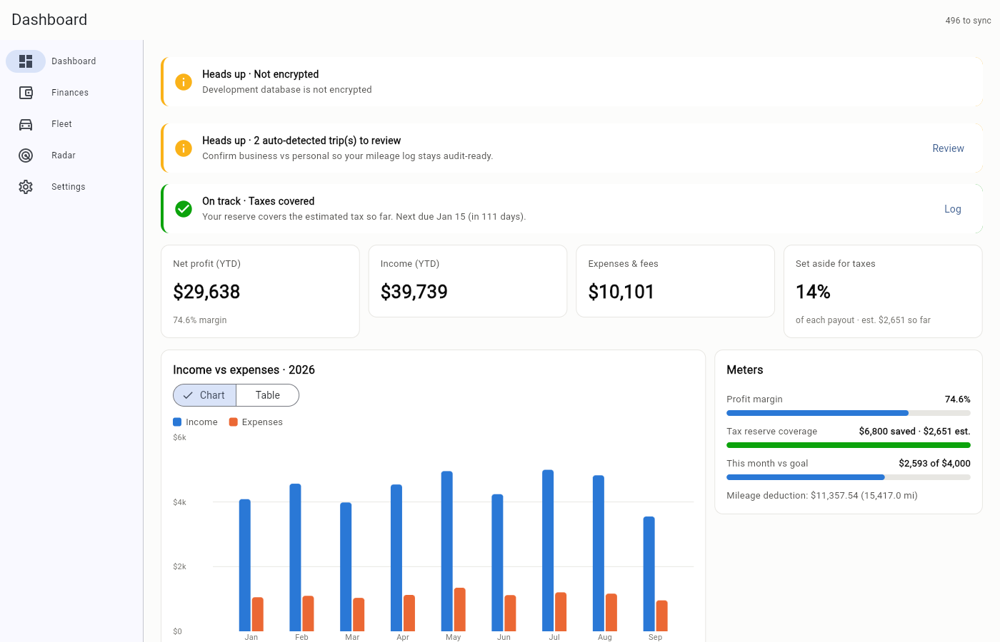

# iFlow Core

Operational command center and financial suite for independent gig workers and
contractors. Local-first: all data lives in an encrypted SQLite database on the
device; an optional self-hosted FastAPI service handles multi-device sync.

**Status:** Phase 11: Admin Portal & Management Dashboard, polished (0.12.0, awaiting sign-off). Phase 10: the AWS deployment (10.4) is built and tested and waits for an AWS account; "Sign in to iFlow" (10.5) is in; on-device checks remain. Plan: [docs/phase10-plan.md](docs/phase10-plan.md).



## Layout

```
core/          business logic, config loader, security (key handling)
  config.py    env flags + user preferences (units, ISO 4217 currencies)
  security.py  DB key resolution/validation, per-platform storage policy, device keystore
  platform.py  runtime platform detection (desktop vs Android/iOS)
  crypto.py    AES-256-GCM field sealing for platform-protected mobile storage
  account/     account API client (sessions sealed in device settings) + Google desktop sign-in (PKCE)
  admin/       operator portal client for the AI service's admin API (never touches local user data)
  sync/        end-to-end encrypted sync: crypto (Argon2id/AES-GCM key hierarchy), engine, manager
  web/         browser build: encrypted vault in the browser's private storage (OPFS), session glue
  buildinfo.py _build_info.json (channel/version/target) → packaged apps default to production
  selftest.py  deployment self-test shipped in every build (`main.py --selftest`)
  financial/
    money.py      integer money: parsing, bp rates, FX conversion, allocation
    ingestion.py  CSV/PDF statement parsers + JSON mapping profiles
    expenses.py   keyword auto-tagger, deductibility, receipt attachments
    tax.py        SE tax, federal/state brackets, QBI, mileage, quarterly estimates
    tax_tables/   bracket data (JSON, minor units + bp) with sources
    exports.py    QFX/OFX, QIF, CSV (generic + QuickBooks), mileage CSV
  timeutil.py   UTC storage ↔ local calendar dates
  telemetry/
    reporter.py   crash/error capture: hooks, local JSONL log, deduped upload queue, opt-in flush
    scrub.py      redacts paths, URLs, emails, keys, amounts, VINs, coordinates before anything is stored
  intelligence/   Personal Intelligence, 100% on-device (no network imports; enforced by a test)
    data.py       one period of earnings (base currency) + confirmed business trips; date-only rows flagged
    sessions.py   work sessions (hours worked) + exact local-hour splitting (DST, +5:30/+5:45 zones)
    matching.py   earnings ↔ trips by time (pay belongs to the hours it was driven)
    temporal.py   7×24 hour-of-week grid, day/week/month trends (local calendar, split-year safe)
    peaks.py      peak earning windows: evidence-weighted (shrunk) rates, ≥3 weeks, wrap past midnight
    zones.py      coarse geohash cells for trip ends: opt-in, home-suppressed, sealed on mobile, never synced
    spatial.py    zone ranking (shrunk per-trip pay), airport merge, relative heat grid (no coordinates)
    metrics.py    net per hour / per mile / after IRS-rate car costs, utilization
    engine.py     build_report(): everything the Insights view shows, with previous-period comparison
  licensing/      Freemium tiers, 100% offline (no network imports; enforced by a test)
    tiers.py      Solo Core / iFlow Pro / iFlow Health & Guild and the feature flags each includes
    pricing.py    integer price book (699 / 6000 / 1499 USD cents), annual savings, proration quotes
    tokens.py     Ed25519-signed license tokens (RSL1.…), verified with a bundled public key
    state.py      free → active → grace → expired / invalid; clock-rollback guard; FeatureLocked
  guild/          premium math + plan/reserve ledger (one active plan per line: health, dental, life)
    premiums.py   withholding rate (rounded up), due-date cycles, tax + health payout split
    store.py      plans (carrier, brokerage, coverage tier, status) + premium reserve ledger
  health/         iFlow Health engine (no medical data modeled anywhere)
    models.py     lines, coverage tiers, member profile, offers, eligibility rules
    compliance.py co-employment guardrails; fields never sent (platform, payroll, medical)
    eligibility.py AHP pre-check from the profile + local work evidence (earnings, hours)
    brokers.py    approved brokerages: offline sandbox catalog, HTTPS REST adapter, minimized payloads
    enrollment.py browse → pre-check → consent → enroll → status
    withholding.py fractional withholding driven by the earnings stream; reserve status; platform split
  ai/
    client.py     HTTPS client for the self-hosted AI service (bearer token, stdlib transport)
    receipts.py   extracted fields → reviewable integer-money draft → expense + managed receipt
    tax_assistant.py  aggregate-only context from the tax engine for grounded tax Q&A
  fleet/
    geo.py        haversine, noise-filtered GPS route distance, geohash
    mileage.py    trip start/stop, distance resolution, IRS split-year calculator
    vehicle.py    vehicle assets, odometer, fuel/MPG, depreciation, fleet assignment
    maintenance.py  schedules, service records, due/overdue triggers
    demand.py     event & flight feeds (ICS, Ticketmaster, OpenSky), demand radar
    vin.py        offline VIN validation (check digit, model year)
    nhtsa.py      base decoder — NHTSA vPIC (free)
    dataone.py    DataOne client — trims, equipment, pricing, maintenance
    decoder.py    facade: NHTSA → DataOne overlay, graceful fallback
    cache.py      raw-payload cache in the encrypted DB (DataOne is billed per decode)
database/      persistence layer
  connection.py  pooled SQLite/SQLCipher manager, pragmas, transactions, mobile fallback
  encryption.py  in-place plaintext → SQLCipher migration (sqlcipher_export)
  schema.sql     v1 baseline schema
  migrations.py  user_version-based migration runner
  migrations/    0002 import_mappings + receipts, 0003 vehicle_decode_cache,
                 0004 vehicles, assignments, fuel_logs, maintenance, trip lifecycle,
                 0005 auto-trip review, device_settings, demand_feed_cache, tax_set_asides,
                 0006 trip_zones (local-only coarse cells), 0007 health_plans + health_premium_entries,
                 0008 coverage lines / enrollment fields, auto-withholding link to transactions
  motion/
    sentry.py     trip detection state machine (> 10 mph start, dwell stop, battery profiles)
    classifier.py business / commute / personal suggestion with reasons
    service.py    persists detected trips (needs_review) via the mileage module
    policy.py     location-permission flow (Google Play / iOS rules)
  device_settings.py  per-device settings; sensitive fields sealed on mobile
ui/
  app.py        root app: secure unlock, routing, adaptive shell, error boundary
  brand.py      logo / emblem helpers (theme-aware), assets directory
  router.py     route table + lock guard (framework-free)
  layout.py     window size classes → nav type, columns, touch targets
  theme.py      tokens (validated chart palette, status colors)
  format.py     integer → display strings (money, %, distance)
  state.py      AppState + Unlocker (passphrase, lockout)
  motion_bridge.py  Flet geolocator ↔ sentry (disclosure, foreground service)
  viewmodels/   dashboard, finances, fleet, radar, intelligence, settings, ai (pure, testable)
  components/   cards, KPI tiles, meters, status banners, bar chart + table, insights (heatmap, trend, area grid)
  views/        dashboard, finances (+ ai_cards, finance_tools: export & Health & Guild), fleet, radar,
                intelligence (/insights), health (/health), pricing (/plans), settings, unlock
images/         source artwork (logo as supplied; not bundled)
assets/         bundled brand images: brand/logo.png, logo_dark.png, emblem.png; icon.png (flet build);
                icons/iflowcore.png|.ico|.icns (desktop installers), generated by scripts/make_brand_assets.py
main.py         entry point (`--selftest` runs the deployment self-test and exits)
scripts/
  seed_demo.py            demo data for a dev database
  make_brand_assets.py    images/ifc_logo.png → transparent logo, dark variant, emblem, app icons (needs numpy, scipy)
  package_web.py          web app (runs in the browser via Pyodide) → build/web/site + dist tarball; see docs/deploy-web.md
  build_common.py         allowlist staging, secret scanning, pyproject validation, manifests
  package_desktop.py      Linux .tar.gz/.deb/.AppImage · macOS .app/.dmg · Windows .exe (PyInstaller or flet build)
  package_mobile.py       Android .aab/.apk · iOS .ipa (flet build) with SQLCipher-less fallback check
  validate_deployment.py  end-to-end deployment validation (config, self-tests, stages, binaries, dist/)
requirements-build.txt    dev requirements + PyInstaller
api/           account & sync API (FastAPI, PostgreSQL, Alembic): email + Google sign-in, sessions, devices
               and the end-to-end encrypted sync store (see api/README.md)
infra/         AWS CDK (Python) for the sync API: ECS Fargate, RDS PostgreSQL, WAF, SES; runbook in infra/README.md
services/ai/   self-hosted AI service (Docker): receipt OCR+LLM, tax Q&A, crash-report intake — see its README
tests/         pytest suite — every DB test runs on plain SQLite and SQLCipher
```

## Run the app

```bash
python main.py                                   # desktop window
flet run main.py                                 # hot reload during development
flet run --web main.py                           # in a browser
IFLOW_DATA_DIR=/tmp/rs-demo python scripts/seed_demo.py   # optional demo data (dev DB)
python main.py --selftest                        # deployment self-test (also works inside packaged apps)
```

Packaged apps: see [Build & package](#build--package).

## Setup

```bash
python3 -m venv .venv && source .venv/bin/activate   # Python 3.10+
pip install -r requirements-dev.txt
pytest
```

SQLCipher drivers (desktop only): Linux uses the prebuilt `sqlcipher3-binary`
wheel. On macOS run `brew install sqlcipher` before installing; on Windows,
install SQLCipher via vcpkg, then `pip install sqlcipher3`. Without a driver, dev mode still works unencrypted (tests for the
encrypted path are skipped).

## Build & package

Every build runs from an **allowlisted stage** (`build/stage/<target>/`: `main.py`, `core/`, `database/`,
`ui/`, `pyproject.toml`, plus `_build_info.json`), never from the working tree. Tests, the AI service, the
API, scripts, virtualenvs, databases, `.env` files and keys can't get in: staging refuses anything that looks
like user data or signing material, and a secret scan runs on the stage and again on the finished artifacts.
No encryption key is ever bundled or needed at build time. Desktop databases are keyed by the passphrase the
user enters at unlock; mobile devices create a random key in the Keychain/Keystore on first launch.

Packaged apps default to **production** (via `_build_info.json`): SQLCipher required on desktop, simulated
licenses refused, no `IFLOW_ENV` needed. `--channel qa` or `--channel dev` builds exist for testing.

### Prerequisites

| Target | Build on | Needs |
|---|---|---|
| Linux `.tar.gz` / `.deb` / `.AppImage` | Linux | Python 3.10+, `requirements-build.txt`, `sqlcipher3-binary`; `dpkg-deb` for .deb, [`appimagetool`](https://github.com/AppImage/appimagetool) for .AppImage |
| macOS `.app` / `.dmg` | macOS | Python 3.10+, `brew install sqlcipher`, then `pip install sqlcipher3`; Xcode CLT |
| Windows `.exe` | Windows | Python 3.10+, `sqlcipher3` built against SQLCipher (e.g. vcpkg `sqlcipher`) |
| Android `.aab` / `.apk` | Linux, macOS or Windows | [Flutter SDK](https://docs.flutter.dev/get-started/install); `flet build` installs the JDK and Android SDK if missing |
| iOS `.ipa` | macOS | Flutter SDK, Xcode, an Apple developer team, and a provisioning profile |

Desktop binaries **must be built on their own OS**: PyInstaller and Flutter don't cross-compile. CI with one
runner per OS is the usual setup. Every script supports `--dry-run` on any host: it runs the checks, stages,
scans, and prints the exact build command.

### 1. Prepare (once per machine)

```bash
python3 -m venv .venv && source .venv/bin/activate      # Windows: .venv\Scripts\activate
pip install -r requirements-build.txt                     # dev deps + PyInstaller + flet CLI
pip install sqlcipher3-binary                             # Linux; macOS/Windows: pip install sqlcipher3
python scripts/validate_deployment.py                     # config + self-tests + stages must all PASS
```

### 2. Desktop

```bash
python scripts/package_desktop.py                        # host OS, PyInstaller backend, production channel
```

That one command:

1. Checks that pyproject has the desktop/mobile split, that SQLCipher is importable, and that the build tools
   are present.
2. Stages the app and scans it for secrets.
3. Runs `flet pack` (PyInstaller).
4. Bundles `database/schema.sql`, `database/migrations/*.sql` and the tax tables at their source-relative
   paths, along with the `sqlcipher3` extension, its OpenSSL/SQLCipher libraries, `tzdata` and the Flet
   desktop client (so the first launch works offline).
5. Verifies that every bundled project module came from the stage.
6. Runs the frozen app's own `--selftest` and fails the build unless SQLCipher works inside the binary.
7. Scans the unpacked bundle and the archives, then writes `dist/iFlowCore-<v>-<target>-manifest.json` with
   SHA-256 hashes and the self-test report.

Per OS:

```bash
# Linux  → dist/iFlowCore-<v>-linux-x86_64.tar.gz, dist/iflowcore_<v>_amd64.deb (+ .AppImage if appimagetool)
python scripts/package_desktop.py --formats tar,deb
sudo apt install ./dist/iflowcore_0.9.0_amd64.deb && iflowcore

# macOS  → dist/iFlowCore-<v>-macos-arm64.zip (iFlowCore.app) + .dmg
python scripts/package_desktop.py --icon assets/icon.icns --codesign-identity "Developer ID Application: …"
xcrun notarytool submit dist/iFlowCore-0.9.0-macos-arm64.zip --keychain-profile notary --wait   # distribution

# Windows → dist\iFlowCore-<v>-windows-x86_64.exe (single file; --onedir for a zipped folder)
python scripts\package_desktop.py --icon assets\icon.ico
```

Options: `--channel production|beta|qa|dev`, `--formats`, `--icon`, `--onedir` (Windows),
`--skip-selftest`, `--dry-run`, and `--backend flet`. The flet backend uses `flet build linux|macos|windows`
(Flutter shell, needs the Flutter SDK and a native toolchain) instead of PyInstaller, then run
`<app> --selftest` by hand.

### 3. Mobile

```bash
python scripts/package_mobile.py android --dry-run          # checks without Flutter
python scripts/package_mobile.py android                    # → dist/iFlowCore-<v>-android.aab (Google Play)
python scripts/package_mobile.py android --format apk --split-per-abi   # sideload / testing
python scripts/package_mobile.py ios --team-id ABCDE12345 --export-method app-store-connect   # macOS only
```

Before building, the script:

- Checks that the mobile targets add `flet-secure-storage` and never SQLCipher. No SQLCipher wheel exists for
  Flet's mobile Python, and adding one would fail at `flet build` time.
- Byte-compiles every module in the stage.
- Runs the staged app's self-test as android or ios with `sqlcipher3` made unimportable. This proves that the
  SQLite fallback (platform-protected storage plus AES-GCM sealed settings) initializes, migrates and renders
  every screen.
- Pins the mobile Python to the version the tests ran on (`--python-version` to override; Flet otherwise
  picks the newest it supports), and checks the Android ABIs against it.
- Validates signing.

After `flet build`, it extracts the .aab/.apk/.ipa and the app archive inside it, secret-scans the contents,
and writes a manifest.

**Android release signing:** keep the upload keystore **outside the project**. Provide it only through the
environment (CI secrets), never through pyproject.toml or the command line:

```bash
export FLET_ANDROID_SIGNING_KEY_STORE=~/keys/iflowcore-upload.jks
export FLET_ANDROID_SIGNING_KEY_ALIAS=upload
export FLET_ANDROID_SIGNING_KEY_STORE_PASSWORD=…   FLET_ANDROID_SIGNING_KEY_PASSWORD=…
python scripts/package_mobile.py android
```

Without a keystore the build is debug-signed: fine for testing, rejected by Play. On **iOS**, the team ID,
profile and certificate are names; the certificate itself stays in the macOS keychain.

Mobile configuration lives in `pyproject.toml`:

- `[tool.flet.android]`: dependencies, ABIs, permissions (location, foreground service, notifications,
  internet).
- `[tool.flet.ios.info]`: location usage strings and the `location` background mode.
- Bundle ID `dev.iflowcore.app`, build number derived from the version (0.9.0 → 900).

### 4. Validate a release

```bash
python scripts/validate_deployment.py --binary build/pyinstaller/linux/dist/iFlowCore/iFlowCore --dist
./iFlowCore --selftest              # on any machine: any packaged app checks itself (add --json for CI)
```

`validate_deployment.py` runs these stages:

- **config:** all 5 targets.
- **source self-test:** assets, DB init, migrations v1→v8 with data preserved, SQLCipher handshake (wrong
  key refused, file not plaintext, plaintext → encrypted upgrade), mobile storage, production defaults, and UI
  startup (8 routes at phone and desktop width).
- **mobile fallback:** android and ios.
- **stages:** all 5 targets.
- **binary** (optional): the packaged app's self-test, which must run frozen and encrypted.
- **dist:** every artifact matches its manifest checksum and scans clean.

## Environment variables

| Variable | Default | Notes |
|---|---|---|
| `IFLOW_PLATFORM` | detected | `android` / `ios` / `linux` / `macos` / `windows` / `web` (tests, emulators) |
| `IFLOW_ENV` | `development` | `development` / `test` / `production` |
| `IFLOW_DEBUG` | true in dev | |
| `IFLOW_DATA_DIR` | OS app-data dir | Falls back to Flet's `FLET_APP_STORAGE_DATA`, then platformdirs |
| `IFLOW_DB_PATH` | `<data_dir>/iflowcore.db` | |
| `IFLOW_DB_KEY` | — | Passphrase (≥12 chars) or 64-hex raw key |
| `IFLOW_REQUIRE_ENCRYPTION` | true in production | Can't be disabled in production |
| `IFLOW_DB_POOL_SIZE` | `4` | |
| `IFLOW_API_URL` | — | Must be `https://` in production |
| `IFLOW_SYNC_ENABLED` | true if API URL set | |
| `IFLOW_UNITS` / `CURRENCY` / `CURRENCIES` / `LOCALE` | — | Override preferences (tests/CI) |
| `IFLOW_DATAONE_CLIENT_ID` / `IFLOW_DATAONE_AUTH_CODE` | — | Enables DataOne enrichment |
| `IFLOW_DATAONE_URL` | built-in | Override the DataOne endpoint (https only) |
| `IFLOW_TICKETMASTER_KEY` | — | Ticketmaster Discovery API key (events) |
| `IFLOW_OPENSKY_CLIENT_ID` / `IFLOW_OPENSKY_CLIENT_SECRET` | — | OpenSky OAuth2 client (historical arrivals) |
| `IFLOW_LICENSE_PUBKEYS` | — | Trusted vendor license keys (comma-separated hex Ed25519) until the production key is pinned |
| `IFLOW_HEALTH_BROKERS` | — | Approved brokerages: `id|Name|https://api.example.com`, comma-separated (HTTPS only) |
| `IFLOW_AI_URL` | — | Self-hosted AI service; `https://` required in production (Settings can override) |
| `IFLOW_AI_TOKEN` | — | Bearer token for the AI service (otherwise stored sealed in the encrypted DB) |

## Key design decisions

- **Money is integer minor units + ISO 4217 code.** Never floats. Each accepted
  currency has a known exponent (`CURRENCY_MINOR_UNITS`), so JPY (0) and KWD (3)
  are exact. `base_amount_minor` pins the converted value at record time.
- **Distances are integer meters.** Imperial/metric is display-only.
- **Rates are basis points** (`2200` = 22%).
- **UUID primary keys**, generated by the app, so any device can create rows
  offline. A UUIDv4 SQL default exists as a fallback.
- **Soft deletes** (`deleted_at`) so deletions propagate through sync. Unique
  indexes are partial (`WHERE deleted_at IS NULL`).
- **Sync tracking** per row: `version`, `sync_status` (`pending`/`synced`/
  `conflict`), `last_synced_at`, `last_modified_device`. Triggers bump
  `version`/`updated_at` and mark rows `pending` on any normal app update. The
  sync engine skips that by writing `updated_at` or `sync_status` itself.
- **Encryption is never silently skipped on desktop.** If a key is supplied or
  encryption is required and SQLCipher isn't available, opening the DB fails.
  Mobile uses an explicit, audited fallback (see below).
- **Durability:** WAL + `synchronous=FULL`, foreign keys verified ON,
  `secure_delete`, in-memory temp store.

## Storage & encryption by platform

The platform is detected at startup (`core/platform.py`): `IFLOW_PLATFORM`
override → Flet's `FLET_PLATFORM` → `sys.platform` → Android API probe.

| | Windows / macOS / Linux | Android / iOS |
|---|---|---|
| Database | SQLCipher, AES-256 (PBKDF2-HMAC-SHA512 for passphrases) | SQLCipher if a driver is bundled, otherwise standard SQLite |
| Key | Passphrase (or `IFLOW_DB_KEY`) | Random 256-bit device key in the iOS Keychain / Android Keystore (`flet-secure-storage`), created on first run |
| Driver missing | **Fails loudly** (unchanged Phase 1 behaviour) | Opens as *platform-protected* SQLite: app sandbox, OS file encryption, file mode 0600 |
| Sensitive settings (home, zones, API keys, calendar URLs) | Inside the encrypted DB | AES-256-GCM sealed with an HKDF key from the device key; refused if no key |
| Unlock UI | Passphrase / create | None: automatic, with a retry screen if secure storage fails |

Platform-protected SQLite is **not equivalent to SQLCipher**: ledger rows rely on the OS
sandbox and device encryption, so a rooted/jailbroken device or an unencrypted backup can
read them. When a mobile SQLCipher driver ships, the next launch encrypts the existing file
in place with the device key (`database/encryption.py`, `sqlcipher_export`, verified before
swap). Settings → Security shows which mode is active.

Build dependencies are per target: `[tool.flet.<linux|macos|windows>]` add the SQLCipher
driver, `[tool.flet.<android|ios>]` add `flet-secure-storage` only.

## Phase 1 verification

- [x] Directory structure and dependencies
- [x] Connection manager: driver selection, FK enforcement, pooling, transactions, auto-init
- [x] Normalized schema: platforms, transactions, expenses, mileage_logs, tax_profiles
- [x] Config loader: env flags, units, multi-currency
- [x] Test suite passing on Python 3.10 and 3.11, plain SQLite and SQLCipher
- [x] Review and sign-off before Phase 2

## Phase 2 verification

- [x] Integer money core: strict parsing, half-up rounding, lossless allocation, FX with exponents
- [x] Ingestion: schema-driven CSV/PDF mapping profiles (Uber/Lyft/TaskRabbit starters), dedupe, DB import
- [x] Expenses: keyword auto-tagger with user rules + learned vendor history; receipts (managed/linked, SHA-256)
- [x] Tax: SE tax, 2025/2026 federal brackets, QBI, CA/IL/PA + no-tax states, effective-dated mileage rates
- [x] Exports: QFX/OFX 1.02, QIF, CSV (generic, QuickBooks 3/4-column), mileage CSV
- [x] Fleet: VIN validation, NHTSA base decoder, DataOne client (trims, equipment, maintenance), cache
- [x] 361 tests passing on Python 3.10 and 3.11, plain SQLite and SQLCipher
- [ ] Verify DataOne wire format against a real account response (docs are not public)
- [ ] Verify built-in platform CSV profiles against real exports
- [x] Review and sign-off before Phase 3

## Phase 3 verification

- [x] Trips: live start/stop, manual entry, one active trip per vehicle; distance from manual > odometer > GPS with cross-checks
- [x] IRS calculator: rate by local trip date (2026: 72.5¢ to Jun 30, 76¢ from Jul 1), per-period rounding shared with the tax engine, 35¢/mi basis reduction
- [x] Vehicles: VIN registration via NHTSA + DataOne (cached), monotonic odometer, fuel/charging logs → expenses, full-to-full MPG, ¢/mi
- [x] Depreciation: MACRS 5-yr / ADS with §280F caps (Rev. Proc. 2025-16, 2026-15)
- [x] Fleet: platform/default assignments with overlap rules; auto vehicle pick on trip start
- [x] Maintenance: OEM/generic/user schedules, severe-service intervals, distance/time triggers fired on trip stop
- [x] Demand radar: ICS parser, Ticketmaster + OpenSky clients, event/airport windows, ranking
- [x] 455 tests passing on Python 3.10 and 3.11, plain SQLite and SQLCipher
- [ ] Verify OpenSky auth/endpoint against a live account
- [x] Review and sign-off before Phase 4

## Phase 4 verification

- [x] Responsive shell: bottom nav < 600 dp, rail < 840 dp, extended rail on desktop; 48 dp touch targets on phones
- [x] Secure startup: env key / passphrase prompt / first-run create; escalating lockout; lock-now; unlock guards every route
- [x] Dashboard: net profit & margin, tax set-aside alert (good/warning/serious/critical, icon + label), meters,
      income vs expenses chart with legend, exact tooltips and a table view
- [x] Radar: ICS / Ticketmaster / OpenSky feeds cached in the encrypted DB; instant render from cache, background refresh
- [x] Motion sentry: strict > 10 mph start, dwell/red-light/signal-loss handling, trips saved for review, classifier
- [x] Rendered with the real Flet web client at phone and desktop widths (docs/screenshots)
- [x] 575 tests passing on Python 3.10 and 3.11, plain SQLite and SQLCipher
- [ ] On-device check of background trip detection (Android foreground service, iOS background updates)
- [x] Mobile storage blocker resolved with platform-conditional storage (see "Storage & encryption by platform")
- [x] Review and sign-off before Phase 5

## Phase 11 verification

- [x] **Admin API** (`services/ai/iflow_ai/admin.py`, mounted at `/admin/v1`):
  - **Auth:**
    - Several admin tokens (`RS_AI_ADMIN_TOKENS`), stored as SHA-256 digests.
    - Each request is compared in constant time against *every* digest (no early exit, which is tested).
    - Client tokens never grant admin; failed attempts are locked out per IP.
    - The routes answer 404 when no admin token is set.
  - **Audit log:** records actor slot, action and target, never tokens. A test checks that tokens and
    the signing key never reach the logs.
- [x] **Licenses:**
  - Ed25519 signing on the server (`RS_AI_LICENSE_SIGNING_KEY`, 64 hex; the app's public simulation
    key is refused).
  - Tokens are byte-compatible with the app's offline verifier, tested by verifying issued keys through
    `core/licensing`.
  - The price book mirrors the app's, a test catches any drift, and callers can't set prices.
  - Integer cents throughout: terms × unit price, and complimentary = 0.
  - The ledger and monthly revenue hold only an opaque customer reference; emails and names are refused.
- [x] **Telemetry triage:**
  - Resolve and reopen; an issue that recurs after being resolved reopens automatically.
  - Purge reports older than N days.
  - Counts shown instead of install ids, and install ids are stripped from report bodies (on the older
    endpoint too).
- [x] **Health monitor:**
  - Uptime and container detection; Tesseract version or the reason it's unavailable; model states.
  - Queue slots and waiting requests; requests by status class and area (no ids); p50/p95 latency;
    429 count; disk and database size.
- [x] **Admin Console** (`admin_console.py`, `ui/admin_console/`): a separate desktop app with its own
  sign-in page. The in-app `/admin` page and the Settings → Operators card are gone.
  - Sign in with a username and password (or a service token). Temporary passwords force a change first.
  - The navigation rail shows only what the role allows: Overview, Users, Licenses & revenue, Parser
    Studio, Crash reports, System health, Audit trail, My account.
  - The session is held in memory only. The console returns to sign-in when the server ends it.
- [x] **Console accounts** (`services/ai/iflow_ai/admin_users.py`):
  - Argon2id passwords, lockout after 5 failures, 30-minute idle and 12-hour sessions.
  - Roles: owner, administrator, developer and support.
  - Owner guardrails: only owners manage owners, nobody changes their own role or disables themselves,
    and there is always an active owner.
  - Resets, role changes and disabling revoke sessions. A bootstrap CLI creates the first owner.
- [x] **Users page:** a directory with inline role changes, disable/enable (confirmed), password reset
  (confirmed; the temporary password is shown once), unlock, an add-user form and the permissions matrix.
- [x] **Parser Studio** (`core/financial/parsers/dynamic.py`, `ui/views/admin_parser_studio.py`,
  `services/ai/iflow_ai/parsers.py`):
  - JSON schemas map columns to roles (gross, tips, quests, fees, tolls, date, payout date, reference),
    with regex extractors and basis-point multipliers.
  - The regex rules match on server and app: no nested quantifiers or backreferences, at most 300
    characters, and a capture group is required.
  - Test Parse runs locally with an integer-cent preview (net = gross + tips + quests − fees; tolls are
    pass-through).
  - Drafts, versioned publish (confirmed) and version history.
  - An Ed25519-signed `IFPB1` bundle that the app verifies against vendor keys; downgrades are refused.
  - Ingestion profiles v2 (extractors, multipliers, payout date) set `schema_version` 2, so older apps
    refuse them rather than misparse.
- [x] **Format distribution by CDN** (0.12.0):
  - Publishing in the Studio writes static files: `v1/bundle.ifpb`, `v1/latest.json`, and an immutable
    `v1/archive/…`.
  - They go to a private S3 bucket behind CloudFront at `formats.iflowcore.com`
    (`infra/iflow_infra/formats_stack.py`), or to a folder when self-hosting.
  - No API route serves formats to apps; the old `/v1/parsers/bundle` route was removed.
  - Apps check once a day (switchable off) with an anonymous GET and an ETag, verify the Ed25519
    signature against the vendor key pinned in `core/licensing/tokens.py`, and refuse downgrades.
  - A tampered or unsigned bundle is rejected (tested with a "compromised bucket").
  - Settings → Statement formats has "Check now" and "Import format file" (the offline route).
- [x] **Import recognises the statement:**
  - Choosing a CSV in Finances picks the format from its header line, even below a preamble.
    Published formats beat the user's own formats, which beat the built-ins.
  - It also picks the matching platform and says "Recognized: …".
  - Unknown files are shown as unrecognized instead of being previewed with the wrong format.
- [x] **Studio in plain language:**
  - "Read the value": whole cell / first number / number after a label… / custom regex.
  - "Amount is": as shown / flip the sign / a percentage….
  - Regex and basis points are generated underneath.
  - Each column shows "Example from your sample: … reads as $5.00".
  - "Load sample file…" (local only).
  - A "Live on the CDN" status with "Send to CDN".
- [x] **Admin Console packaged** (`scripts/package_desktop.py --app console` builds
  `iflowcore-admin_0.12.0_amd64.deb` and a tarball):
  - It launches from the app menu with no terminal. "This computer" runs the admin service inside the
    console on 127.0.0.1 (`ui/admin_console/local_service.py`).
  - The first launch offers to create the owner account. The vendor signing key is created 0600 in
    `~/.local/share/iflow-ai`; only its public half is shown.
  - Publishing to the CDN is configured in My account.
  - The build bundles only the admin service: no AI models, and only the botocore data it needs.
  - A frozen self-test runs inside the package (service, accounts, publish + verify, UI).
  - The build fails if the signing key's value appears in any artifact.
- [x] **API integrations** (Integration Studio → signed bundle → "Connect a platform" in Finances):
  - `core/integration/schema.py` defines the schema: form fields, auth (OAuth 2.0 + PKCE, a pasted token,
    or none), request path/query templates (`{start_date|epoch}`), pagination, and a mapping from JSON
    paths to integer-cent transactions. It uses validated dataclasses; Pydantic isn't in the mobile build.
  - `core/integration/engine.py` turns form values into URLs, pulls with pagination, joins "details"
    requests (Uber trips) into payment records, and imports through `import_records`, so a repeat pull
    adds only what's new.
  - Safety:
    - Requests only go to the schema's https host, and placeholder values are URL-encoded.
    - The token goes in a header, never in a template; secret fields can't appear in URLs.
    - Redirects are refused (urllib would forward the Authorization header).
    - JSON numbers are read as Decimal, with page and item caps.
    - Tokens live in the sealed `integration_credentials` device setting and are never synced.
  - `core/integration/oauth.py` runs the browser sign-in through a loopback address. Platforms that
    require a client secret (Uber) use the iFlow API's token broker (`api/iflow_api/broker.py`,
    `IFLOW_API_INTEGRATION_CLIENTS`, a Secrets Manager value on AWS), which stores and logs nothing.
  - The Uber template (`core/integration/templates.py`) follows Uber's documented Driver API. It needs
    Uber to approve iFlow for the `partner.*` scopes, and it hasn't been checked against a live response.
  - In the Studio: an "API integrations" tab with templates, a JSON editor validated by the app's model,
    "What users see" (the real form plus preview URLs) and a local test bench. Save and publish ride the
    same signed CDN bundle as statement formats; older apps ignore the new key.
- [x] **Checked in a real browser** (Flet web) against live local services:
  - The console's first-run setup with the built-in service.
  - Studio presets and examples, then Test Parse, save and publish to the stand-in CDN folder.
  - The user app downloading and installing that format on unlock (trusting the QA console's key).
  - "Sign in to iFlow": create account → email code → sync passphrase → recovery key → Synced.
  - Fixed from those checks: a start race when two windows open, banner wording ("Due soon" on errors),
    a font-safe example arrow, and model-less health rows.
- [x] The console is decoupled from user data: it has no AppState or database at all (tested) and only
  talks to the service. Parser Studio samples never leave the operator's machine.
- [x] 1,392 app tests + 40 infrastructure tests passing; the self-test renders all 8 app routes at both widths.
- [ ] Revocation: the ledger records issues, but already-issued keys stay valid until they expire (the app
  verifies offline). A signed revocation list is future work.
- [ ] Review and sign-off

## Phase 10 verification (in progress, plan: [docs/phase10-plan.md](docs/phase10-plan.md))

- [x] **10.1 Rebrand to iFlow Core:** name, window title, installers (`iflowcore` .deb, `/usr/bin/iflowcore`,
      `iFlowCore` binaries), bundle ID `dev.iflowcore.app`, `IFLOW_*` environment variables, version 0.10.0
- [x] Pre-rebrand installs keep working:
      - `RUBYSOHO_*` variables are still read (new names win).
      - The `RubySoho` data directory is moved to `iFlowCore` on first launch, and `rubysoho.db` is renamed to
        `iflowcore.db`, only when it was closed cleanly. Nothing is ever overwritten; if the move fails, the old
        location is still used.
      - The new .deb replaces the old `rubysoho` package.
      - Verified with the packaged binary against a copy of a real pre-rebrand layout.
- [x] Frozen identifiers kept, and pinned by a test: `rubysoho/field-sealing/v1`, `rubysoho.device_key.v1`,
      keychain account `rubysoho`, and the migration marker. Renaming them would lock existing installs out of
      their data.
- [x] Brand artwork: the supplied logo had its "transparency" checkerboard and drop shadow painted into the pixels.
      `scripts/make_brand_assets.py` produces clean transparent versions:
      - Light and dark lock-ups.
      - Emblem.
      - App icon plus .png, .ico and .icns.

      Where they appear:
      - The unlock screens show the logo (light or dark lettering to match the theme).
      - The navigation rail shows the emblem.
      - The .deb installs the menu icon.
      - The self-test checks the images are bundled.
- [x] **10.2 Account service** (`api/`):
      - Email sign-up with emailed 6-digit codes, Argon2id passwords, password reset/change.
      - Google sign-in: ID token verified against Google's keys, `aud`, `iss`, expiry and a verified email.
      - Ed25519 access tokens (15 min) and single-use refresh tokens per device; reuse revokes the device.
      - Devices, sign out, sign out everywhere, account deletion (needs a sign-in in the last 10 minutes).
      - Protections: no enumeration, no pre-hijacking, lockout, rate limits.
      - Production refuses to start with dev defaults.
- [x] Schema via Alembic (`0001_accounts`); the migration is tested to match the models exactly.
      Local stack: `api/docker-compose.yml`.
- [x] App client (`core/account/`):
      - HTTPS only; access token in memory; refresh token in the sealed `account_session` device setting.
      - Auto-refresh; a session revoked elsewhere clears locally.
      - Generic device names (never the hostname).
      - Google desktop sign-in via loopback + PKCE.
- [x] Verified:
      - The full suite also ran on **PostgreSQL 16** (75 tests).
      - Real `uvicorn` + Postgres smoke test.
      - Privacy test: no password, code, token or refresh secret at rest.
- [x] 1,206 tests passing (66 new for 10.2)
- [ ] Google Cloud OAuth client IDs (yours) · native Google Sign-In on Android/iOS (with the 10.5 screens)
- [x] **10.3 End-to-end encrypted sync.**
  - **Keys:**
    - A random account data key, wrapped by Argon2id(sync passphrase) and by a one-time recovery key
      (11 groups of 5 characters, with a typo checksum).
    - The server stores only the wrapped envelope and can't unwrap it.
    - The envelope is bound to its account, and hostile KDF parameters are refused.
  - **Records:**
    - AES-256-GCM, compressed and padded to 256-byte buckets.
    - Each record is authenticated to its account, collection, record ID and version, so the server can't
      move, swap or replay records.
    - Table names are HMAC'd.
  - **Server** (`/v1/sync/*`, migration `0002_sync`):
    - Optimistic-concurrency push, cursor pull, per-account quotas, row-locked sequence numbers.
    - Reset needs a recent sign-in; everything is deleted along with the account.
  - **Engine** (`core/sync/`, local migration 0009):
    - All 15 synced tables, pushed in foreign-key order.
    - Pulls applied atomically with deferred foreign keys; no echo loops.
    - Conflicts go to the newest edit, the same winner on every device, with the losing copy kept for review.
    - Soft deletes propagate.
    - Offline duplicates (same platform, VIN, imported statement line, tax year, …) merge to one row
      everywhere and children are re-pointed; a test fails if a future unique index has no merge rule.
    - Receipt image paths stay on the device.
  - **Verified:**
    - Multi-device runs against the real API: convergence, concurrent edits, deletes, child-before-parent,
      duplicate merge, recovery, passphrase change, account binding.
    - Tampered records stop sync with nothing half-applied.
    - Privacy dump: no amounts, names, VINs, descriptions or table names on the server.
    - Server tests also run on PostgreSQL 16.
- [x] 1,239 tests passing (33 new for 10.3)
- [x] **Web app** (`scripts/package_web.py`, deploy guide: [docs/deploy-web.md](docs/deploy-web.md)):
  - **How it runs:** the whole app runs in the browser (Pyodide, Python 3.14); the server only serves
    static files.
  - **Storage:** SQLite runs in memory while unlocked. After every change it's saved as an AES-256-GCM
    snapshot (Argon2id of the passphrase) in the browser's private storage (OPFS). Two alternating slots
    mean an interrupted save can't lose data, and a second tab is locked out. Browser HTTP uses synchronous
    XHR. The API accepts the web origin via `IFLOW_API_CORS_ORIGINS`.
  - **Verified in a real browser:**
    - It boots and runs all 9 migrations on the browser's SQLite 3.39.
    - A vehicle added through the UI survives a reload.
    - The wrong passphrase is refused and the right one restores the data.
    - Browser storage holds only ciphertext.
    - A second tab is refused.
  - 20 new tests.
- [x] **Android APK built** on this machine:
  - **Toolchain:** Flet installed Flutter 3.44.8, JDK 17 and the Android SDK itself.
  - **Output:** `dist/iFlowCore-0.10.0-android.apk` (162 MB, debug-signed, `dev.iflowcore.app`, API 36;
    arm64-v8a, armeabi-v7a and x86_64).
  - **Fixes the real build forced:**
    - The secret scan caught sample RSA keys in the `cryptography` wheel's bundled test suite; third-party
      test suites are now stripped (`[tool.flet.cleanup]`).
    - A lingering Gradle daemon could break the next stage cleanup; it's now stopped after the build and
      the cleanup is resilient.
  - [ ] Installed and run on a real phone.
  - [ ] Play release (upload key, `.aab`).
- [ ] Receipt **images** don't sync yet (metadata does; other devices show them as "on another device")
- [x] **10.4 AWS deployment, built and tested** (`infra/`, runbook in [infra/README.md](infra/README.md)):
  - A CDK stack for `us-east-1`:
    - ECS Fargate behind a load balancer with WAF, instead of App Runner, which would need a NAT
      gateway. There is no NAT gateway at all.
    - RDS PostgreSQL 16: encrypted, TLS-only, isolated subnets, backups, deletion protection.
    - Secrets Manager, an ACM certificate, and SES with DKIM and MAIL FROM.
    - Migrations run before each rollout.
    - Alarms and a budget alert.
    - About $65/month.
  - The API reads the RDS secret directly (`IFLOW_API_DATABASE_SECRET`, TLS required) and has a
    `/readyz` database check.
  - Scripts: `create_app_secret.py` (keys generated straight into Secrets Manager), `dns_records.py`
    (records to add at the current DNS host), `smoke_test.py`, and `deploy.sh`.
  - 34 infrastructure tests (synthesized template: security properties and the migration trigger) and
    9 API tests.
  - [ ] Deploy to your AWS account; add the DNS records; request SES production access; smoke test.
- [x] **10.5 "Sign in to iFlow"** (Settings → iFlow account & sync; `ui/views/account.py`):
  - Flow: create account → email code → sync passphrase, with a recovery key shown once on the first
    device. Other devices unlock with the same passphrase or the recovery key.
  - Then: sync now, devices (remove), turn off on this device, sign out, and delete account (confirmed).
  - The iFlow-hosted server (`https://api.iflowcore.com`) is the default. "Advanced" is for self-hosters.
  - The shell's chip shows the real state: Sync off / Sync not set up / N to sync / Synced / Sync paused.
  - It syncs on unlock.
  - The self-hosted AI URL/token card is tucked under "Set up a self-hosted AI server…".
  - Tested end to end with two devices on one account against the real API.
- [ ] 10.6: a smoke test after the AWS deploy · Google sign-in (needs your OAuth client IDs)
- [ ] Review and sign-off

## Phase 9 verification

- [x] Desktop packaging (`scripts/package_desktop.py`): PyInstaller via `flet pack` (default) or `flet build`,
      from an allowlisted stage; schema, migrations 0002–0008 and tax tables bundled at source-relative paths;
      the SQLCipher extension and its libcrypto collected; Flet desktop client embedded
- [x] **Linux built and verified on this machine:** `iFlowCore-0.9.0-linux-x86_64.tar.gz` (63 MB) and
      `iflowcore_0.9.0_amd64.deb` (57 MB, root-owned, 0755/0644, `/opt/iflowcore` + `/usr/bin/iflowcore` + desktop
      entry); the frozen binary's `--selftest` passes all 8 checks, including SQLCipher 4.12.0 inside the bundle;
      the binary also passes when extracted from the .deb; the GUI launches under X11 with an empty HOME
- [x] Module provenance: all 108 app modules in the bundle came from the stage, none from the checkout
- [x] macOS (.app/.zip/.dmg, codesign identity) and Windows (.exe one-file / zipped one-dir, version resource)
      are configured and dry-run clean; not built here (they need their own OS)
- [x] Mobile packaging (`scripts/package_mobile.py`): `.aab`/`.apk`/`.ipa`/simulator via `flet build`; mobile
      targets add `flet-secure-storage` and never SQLCipher (validated); SQLite fallback proven by running the
      staged app as android and ios with `sqlcipher3` unimportable (migrations, sealing, all screens pass);
      modules byte-compile; ABIs checked against the pinned mobile Python; signing only from env, keystore
      refused inside the project; artifacts scanned after extracting the nested app archive
- [x] Secrets: staging refuses DBs, `.env`, keys, keystores and logs. Scanner coverage:
      - private keys (bare PEM headers in OpenSSL are not flagged), AWS/GitHub/Slack/Stripe tokens and
        hardcoded credentials;
      - the build machine's own secret environment values, which are also stripped from build subprocesses;
      - `_build_info.json` is limited to 5 metadata keys (checked by the in-app self-test too).
- [x] Packaged apps default to production (encryption required, simulated licenses refused); an explicit
      `IFLOW_ENV` still wins; source checkouts stay development
- [x] `scripts/validate_deployment.py`: config, source self-test, mobile fallback ×2, stages ×5, binary, dist
      checksums: all PASS
- [x] Fixed after the first run of the packaged app, which crashed with "Frozen controls cannot be updated":
      - Cause: re-renders on connect, resize and brightness changes rebuilt keyed controls, and Flet reconciles those
        into immutable ("frozen") controls, so the unlock error message crashed.
      - Fix: each render's content now gets a per-render key, so Flet mounts it fresh.
      - Covered by tests that drive a real Flet session (`tests/test_ui_session.py`) and by a check in the browser.
- [x] A plaintext database left by a development run is no longer a dead end in production builds. Unlock now
      offers "Encrypt & unlock": a verified in-place SQLCipher migration that keeps the data and deletes the
      plaintext copy.
- [x] 1,128 tests passing (99 new for Phase 9)
- [ ] Build and self-test on macOS and Windows runners; code-sign and notarize the macOS app; sign the Windows exe
- [ ] Android and iOS builds with Flutter (not installed here); on-device install test; Play and App Store
      signing
- [x] Review and sign-off (2026-09-27)

## Phase 9 caveats

- **Only the Linux PyInstaller build was produced here.** This machine has no Flutter, Xcode, Android SDK
  or JDK, and no macOS or Windows. The other targets are configured, dry-run clean and covered by tests, but
  haven't been compiled. The first real run on each OS may surface toolchain issues, for example the SQLCipher
  build on Windows.
- **AppImage** needs `appimagetool` (not installed here). The script builds the AppDir and skips the format
  with a warning when the tool is missing, and fails if `--formats appimage` was requested explicitly.
- **Mobile encryption is platform-level.** Android file-based encryption and iOS Data Protection, plus
  AES-GCM sealing of sensitive settings, stand in for SQLCipher; this is unchanged from Phase 4. If a mobile
  SQLCipher wheel appears, add it to `[tool.flet.android|ios]` and the app encrypts on next launch.
- **The mobile runtime is pinned to the tested Python** (3.12 here). A plain `flet build apk` without the
  script would pick the newest Python Flet supports (3.14), and native wheels (`cryptography`) must exist for
  it in Flet's mobile index.
- **Unsigned by default:** without signing configuration, Android builds are debug-signed, macOS builds are
  ad-hoc signed, and Windows builds are unsigned (SmartScreen will warn).
- **Icons:** since Phase 10 the brand icons in `assets/icons/` are used by default (`--icon` overrides).
- The `.deb` declares `libgtk-3-0` (needed by the Flet client) and installs to `/opt/iflowcore`. User data stays
  in the platform data directory, never under `/opt`.

## Phase 8 verification

- [x] Coverage model: health, dental and life lines, one active plan per line, carrier, brokerage, coverage tier
      (self / +spouse / +children / family), pending → active → ended; no medical information anywhere
- [x] Fractional withholding linked to the earnings stream: every payout (imports, manual) is evaluated in time
      order on unlock, after statement imports and on /health; one reserve row per (payout, plan), idempotent,
      reversed if the payout is deleted
- [x] Strategies: auto (need ÷ expected earnings until the earliest due date, counting reserve on hand and payments
      already made), percent (¢ per $), fixed per payout, off; 25% default cap; per-platform exclusion; refunds
      and reimbursements never withheld; foreign-currency payouts via pinned base amounts only
- [x] Integer money: lossless split across plans by premium share, rounded-up withholding, weekly need
      (× 12 / 52, rounded up); verified to land on the premium to the cent by the due date (no overshoot)
- [x] Multi-platform: per-platform contribution table (all payouts counted, including ones that needed nothing)
- [x] Eligibility pre-check (pass / fail / unknown): service area, age (birth-year edge → unknown, never guessed),
      membership days, self-employment earnings and hours from the local Insights engine, member limit, companion
      line; clearly labelled a pre-screen
- [x] Co-employment guardrails: platform-sponsored, platform-funded or payroll-deducted offers refused; payloads
      checked recursively for platform, payroll and medical fields
- [x] Brokerages: offline sandbox catalog (Bronze/Silver/Gold, dental, term life; integer age/tier rating), HTTPS
      REST adapter limited to an allowlist, bearer tokens sealed, float premiums rejected, errors never echo payloads
- [x] Privacy: quotes send state, age band, coverage tier only; enrollment shows every field (masked) on a consent
      screen and requires an explicit tick; applicant name/email/birth date never stored or logged (tested);
      profile and broker tokens sealed on mobile storage
- [x] /health view: reserve KPIs + funded meter, coverage, platform split, guild catalog by coverage tier with
      eligibility, consent-first enrollment, profile, withholding settings; gated by iFlow Health & Guild (catalog
      preview for everyone); rail entry on wide screens, heart icon in the phone app bar
- [x] Rendered in the Flet web client at 1440 px and 390 px; enrollment and withholding exercised end to end
- [x] 1,029 tests passing (82 new for Phase 8) on plain SQLite and SQLCipher; `core/health` network boundary tested
- [ ] Real brokerage / carrier integration (API contracts, credentials, their compliance review)
- [ ] Legal review of the AHP structure and eligibility rules with the association (see caveats)
- [x] Review and sign-off before Phase 9

## Phase 8 caveats

- **Not insurance, not legal advice.** Whether an association health plan may cover self-employed people with
  no employees depends on federal rules that have changed several times and on state law; the association and
  carrier decide. The app's checks are a pre-screen, and its guardrails keep *its own* behaviour independent of
  gig platforms. They don't make a plan compliant.
- **The sandbox brokerage is fictional** ("Sandbox Mutual (demo)"): prices and benefits are illustrative and no
  coverage is created. Real brokerages need an approved HTTPS endpoint, a contract, and credentials.
- **Withholding earmarks money; it doesn't move it.** The reserve is a ledger in the app; paying the premium is
  still the member's action (recorded with "Premium paid").
- Auto mode funds all active premiums by the *earliest* due date among them (conservative). Payouts that needed
  nothing are re-checked on later syncs, so a newly added plan is funded from recent cash flow.
- Eligibility "hours" come from reconstructed work sessions (Phase 6), so they need trip logs or trip detection.

## Phase 7 verification

- [x] Three tiers with explicit feature flags; each tier includes everything below it (tested per feature):
      Solo Core (free), iFlow Pro ($6.99/mo or $60/yr), iFlow Health & Guild ($14.99/mo)
- [x] Integer pricing: prices in minor units, validated per currency exponent, never FX-converted; annual savings
      (2388¢, 28%), monthly equivalent (500¢), unused-time credit rounded *down*, credit capped at the new price
- [x] Offline licenses: Ed25519-signed tokens verified with a bundled public key; tamper, wrong key, wrong issuer,
      malformed, oversize, out-of-range claims all rejected; token sealed with the device key on mobile storage
- [x] State machine with exact boundaries: FREE → ACTIVE → GRACE (7 days, features on) → EXPIRED (Solo Core) and
      INVALID; clock-rollback guard (hourly "last seen"); a bad key never replaces a good one
- [x] Simulated upgrades only in non-production builds (simulation key is public, so production rejects it);
      production shows "enter your license key" instead
- [x] Gates at the action boundary, never on data: motion sentry (settings + bridge + auto-off at unlock after
      lapse, with a notice), VIN decoding & more than one vehicle, QFX/OFX/QIF/QuickBooks exports, AI receipt OCR,
      AHP pool & premium withholding; plain CSV export free on every tier
- [x] New Export card (exports had no UI before); VIN decoding wired into the app for the first time (offline
      decode failures still save the vehicle)
- [x] Health & Guild: AHP plan + reserve ledger (synced, like tax set-asides), suggested withholding from trailing
      90-day net (same-currency only), due-date cycle status, lossless tax + health payout split
- [x] Plans page (/plans): status, tier cards with checklists, comparison table with text marks, transparent
      upgrade dialog (price, credit, due today, renewal), downgrade dialog listing exactly what pauses
- [x] App-wide dialog fix: dialogs close reliably after a notification + re-render (found in the browser; the
      shell now closes its own dialog and updates the on-screen View in place). Regression-tested.
- [x] Rendered in the Flet web client at 1440 px and 390 px; upgrade/switch/Guild flows exercised end to end
- [x] 947 tests passing (109 new for Phase 7) on plain SQLite and SQLCipher; `core/licensing` statically checked to
      import no network code
- [ ] Pin the production vendor public key in `core/licensing/tokens.py` (`VENDOR_PUBLIC_KEYS`) and build the
      issuing side (store receipts → signed tokens); none exists yet
- [ ] Store billing integration (Google Play / App Store / web checkout) and their policy review
- [x] Review and sign-off before Phase 8

## Phase 7 caveats

- **No real payments exist yet.** Purchases are simulated in development builds; production builds accept only
  license keys signed by a vendor key configured via `IFLOW_LICENSE_PUBKEYS` or pinned in code.
- **Offline licenses can't be revoked** before they expire (no server check, by design). Terms are therefore short
  (one billing period); renewal issues a new key.
- **Licenses aren't bound to a device.** A key works on any device the user copies it to; binding it would need an
  account or an activation server, which the local-first design avoids.
- **Mobile store rules** (Apple/Google) generally require their in-app purchase systems for digital features;
  the license-key path fits the web/desktop channel. Check before shipping to the stores.
- **AHP withholding is a planning tool**, not insurance or payroll: it doesn't pay premiums, and the suggestion
  assumes future earnings look like the last 90 days.
- Existing Phase 1–6 features not named in the tier spec (Insights, radar, tax estimates, AI tax Q&A, crash
  reports) stay in Solo Core so no current user loses anything.

## Phase 6 verification

- [x] Local engine (`core/intelligence/`): earnings in base currency (tax-engine conversion rules), confirmed business
      trips only, reimbursements and unreviewed auto trips excluded and reported
- [x] Integer money throughout: per hour / per mile / per km / per trip / shares all round half-up in minor units;
      pay split across hours with the lossless `allocate()`; distances in meters
- [x] Local time: calendar decisions use the user's zone; hour splitting exact across DST (spring/fall) and
      fractional offsets (Kolkata, Kathmandu); period edges by local date; date-only imports kept out of hourly views
- [x] Split-year: sessions crossing Dec 31 → Jan 1 split hours by local date; monthly trends label years;
      YTD compares with the same dates last year (Feb 29 safe)
- [x] Hours worked from sessions (45-minute gap); lone earnings add no hours (no invented per-hour rates)
- [x] Peak Earning Hours: shrinkage toward the baseline, ≥ 3 weeks and ≥ 30 min evidence, 115% lift, windows wrap
      past midnight and Sunday→Monday, capped at 12 h, ranked by extra money; sparse/no-time data explained
- [x] Payout-lag bias fixed: matched pay credited to the minutes of its trip, not the payout minute
- [x] Spatial: opt-in coarse cells (~1.2 × 0.6 km); home radius + margin *and* home's own cell never stored; sealed
      with the device key on mobile platform storage (bound to trip + column; tamper → unreadable); nothing stored
      when sealing is required but unavailable; not synced; one-tap "forget"; soft/hard deletes respected
- [x] Zones ranked by shrunk per-trip pay; areas with < 3 drop-offs only counted; airports merged; labels are
      relative ("TPA airport area", "3.2 mi ESE of TPA"); heat grid carries row/col only
- [x] Insights view: period chips (30 d / 90 d / 12 mo / YTD), KPI tiles with change vs previous period, peak list,
      7×24 heatmap (24×7 on phones) with ordinal sequential ramp validated for 2:1 on both surfaces, legend, tooltips,
      table views, trend line with gaps, relative area grid; state in the route
- [x] Navigation: Insights in rail and phone bar; phones keep 5 bar items with Settings in the app bar (back arrow)
- [x] Rendered in the Flet web client at 1440 px and 390 px with a year of seeded demo data
- [x] 838 tests passing (103 new for Phase 6) on plain SQLite and SQLCipher; `core/intelligence` statically checked
      to import no network code
- [ ] On-device check that zones are recorded from real trip detection (Android/iOS) and sealed on platform storage
- [x] Review and sign-off before Phase 7

## Phase 6 caveats

- **Hours worked are reconstructed** from trips and earnings (45-minute gap). Platforms' own "online time" isn't
  imported yet; if a statement provides it, it should replace the reconstruction.
- **Earnings ↔ trip matching is by time** (10 min before to 45 min after a drop-off, same platform when known).
  Batched daily payouts can't be matched and stay at their timestamp; statements with per-trip rows work best.
- **Zones need trip detection** (GPS) and opt-in; manual and imported trips have no zone. The "Best-paying areas"
  card says what share of trips have one.
- **Relative, not a map**: the area grid deliberately shows positions relative to each other and to your radar
  airport, without map tiles (which would need a network request that leaks the viewed area).
- "After car costs" uses the IRS standard mileage rate as a cost proxy; actual costs vary.

## Phase 5 verification

- [x] Error reporter installed before unlock: `sys`/`threading` excepthooks, ERROR-level logging (incl. the view
      error boundary), explicit capture; route attached as context
- [x] Scrubbing: user paths, data dir, URLs (feed tokens), emails, keys/bearer tokens, UUIDs, VINs, coordinates,
      amounts, long digit runs; frames keep file/line/function only, never locals
- [x] Local JSONL log with rotation; upload queue deduped by fingerprint (crash loops bump a counter), bounded,
      torn-write tolerant; upload only after opt-in, failures keep the queue
- [x] AI client: HTTPS-only (loopback/dev excepted), token never logged, busy/auth/size errors mapped to messages
- [x] Receipt scan: file type/signature/size checked on device → server OCR + LLM → heuristic cross-check →
      integer-money draft with confidences and warnings → review dialog → expense + managed receipt (no orphan rows)
- [x] Tax Q&A, deterministic first: aggregate-only context with set-aside/per-month/next-payment figures computed
      in integer money; topic gate; template answers for common questions; LLM fallback with a number-grounding
      check; answers labelled "calculated" vs "AI-generated"; disclaimer always shown
- [x] AI service: bearer auth (constant-time), admin token for crash issues, per-token rate limits, inference queue
      with 503/Retry-After, upload caps, in-memory processing, non-root read-only container, Caddy TLS
- [x] Crash-report wire format tested end to end (app reporter → service → grouped issues)
- [x] 735 tests passing on Python 3.12 (models faked; no torch needed)
- [x] Real-model smoke test (Qwen2.5-1.5B-Instruct, CPU, via the real FastAPI app): 4/4 receipts correct; tax
      templates exact; invented numbers caught (results and timings in services/ai/README)
- [ ] Deploy to the IONOS server and run the connection test from a phone build
- [ ] Build the Docker image on the server and confirm Tesseract OCR on real phone photos (not available locally)
- [ ] Measure receipt accuracy on 20–30 real receipts (photos + PDFs) and tune prompts / model size
- [ ] "Actual expenses vs mileage?": compute both methods in the tax engine and answer from a template (the 1.5B
      model answers this open question poorly)
- [x] Review and sign-off before Phase 6

## Phase 5 caveats

- **Consent model:** every off-device feature (receipts, tax Q&A, crash reports) is off by default and toggled
  per device in Settings. Errors are always logged locally (scrubbed) so they can be sent later if the user opts in.
- **Receipt images leave the device** when scanning is on. They go only to the user's own server over TLS and are
  processed in memory; the server logs sizes and timings only.
- **Managed receipts are still plain files** next to the encrypted DB (unchanged from Phase 2).
- **LLM answers can be wrong.** Tax answers are grounded in the app's figures and labelled as estimates; receipt
  fields are cross-checked and always reviewed before saving. Neither replaces the deterministic tax engine.
- Scrubbing is pattern-based: it is deliberately greedy, but novel formats of personal data could slip through,
  which is one more reason uploads are opt-in and go only to the user's own server.
- The AI service is sized for one user or a small team on CPU; heavier use needs more cores, a larger
  `RS_AI_MAX_CONCURRENCY`, or a GPU.

## Dual-mode storage verification

- [x] Platform detection: override, Flet env, `sys.platform`, Android probe; invalid override is a config error
- [x] Desktop: missing SQLCipher with a key or in production raises `EncryptionUnavailableError` (all three OSes)
- [x] Mobile: no driver + encryption required opens platform-protected SQLite without crashing; driver present → SQLCipher
- [x] Device key: created once in secure storage, reused, malformed/unwritable/unavailable store fails with a clear error
- [x] Field sealing: AES-GCM round-trip, bound to field name, tamper and wrong-key detection; unreadable values preserved
- [x] Plaintext → SQLCipher upgrade migration keeps every row and the schema version
- [x] 622 tests passing on Python 3.11 (621 + 1 skipped on 3.10), plain SQLite and SQLCipher
- [ ] On-device: first launch on Android and iOS, key survives app restart, reinstall behaviour
- [ ] Android backup rules: exclude the DB or rely on encrypted backups (Flet doesn't document `allowBackup` yet)

## Phase 4 caveats

- **Mobile encryption:** resolved by platform-protected storage (above). Full SQLCipher on phones still needs a
  driver built for Flet's mobile Python runtime; the upgrade path is already in place.
- **Background location** is implemented per platform policy (prominent disclosure, Android location foreground
  service with ongoing notification, iOS background updates with indicator) but must be verified on real devices;
  OS battery managers can still pause apps.
- `UIBackgroundModes` in `[tool.flet.ios.info]` follows Flet's Info.plist mapping; confirm in the first iOS build.
- Radar airport waves use OpenSky's historical data projected from the same weekday last week (labelled).
- Tax alerts compare reserves/payments with the estimate on income so far; they don't model safe harbor.

## Phase 3 caveats

- The 2026 basis-reduction rate (35¢/mi, Notice 2026-10) is applied all year; Announcement
  2026-11 raised the deduction rate from July 1, and whether it also changed the basis
  reduction still needs checking.
- Depreciation assumes the half-year convention, constant business use, and no bonus/§179.
- GPS points are used only to compute distance and are not stored.
- OpenSky arrival data is historical (next-day), good for learning patterns, not live dispatch.
- Demand weights are heuristics (documented defaults) to be tuned in Phase 4.

## Phase 2 caveats

- Tax output is a planning estimate, not advice. Credits, itemized deductions, AMT,
  and state-specific AGI adjustments aren't modeled; each estimate lists its notes.
- California 2026 uses the 2025 schedules (flagged `provisional`), as FTB prescribes
  for estimated payments until the 2026 schedules are published.
- `tax_profiles.mileage_rate_minor` holds whole cents, so it can't express 72.5¢.
  Official rates live in the tax tables (tenths of a cent); the column is only a
  user override.
- Managed receipts are plain files next to the encrypted DB. Encrypting them is
  planned for the security phase.
